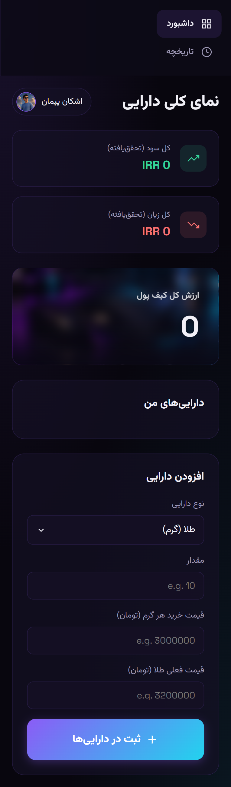

# 💎 Nova Assets — Financial Dashboard

A modern, sleek, and fully responsive financial dashboard built with pure HTML, CSS, and Vanilla JavaScript. This web app helps users track their assets (Gold, USD, EUR, or custom currencies), calculate real-time profit/loss, and manage their transaction history.

## ✨ Features

- Asset Management: Add, edit, and sell assets with custom buy/current prices.
- Realized & Unrealized P&L: Automatically calculates paper profit/loss (on the dashboard) and realized profit/loss (when selling).
- Transaction History: Keeps a detailed log of all buy and sell actions with timestamps.
- Custom Currencies: Users can add any currency they want (e.g., Turkish Lira, AED) alongside standard ones.
- Modern UI/UX: Dark mode, glassmorphism effects, neon glows, and smooth animations.
- Data Persistence: All data is saved locally in the browser using localStorage (no backend needed).

## 🛠️ Tech Stack

- HTML5 (Semantic structure)
- CSS3 (Custom properties, Flexbox, Grid, Glassmorphism, Animations)
- Vanilla JavaScript (DOM manipulation, LocalStorage, ES6 features)
- Google Fonts (Vazirmatn & Space Grotesk)

## 🌐 Language

This project is developed with a Persian (Farsi) user interface. The layout is fully RTL (Right-to-Left) optimized.

## 🚀 How to Run

1. Clone the repository:
   `bash
   git clone [https://github.com/AshkanPeyman/nova-assets-dashboard.git](https://ashkanpeymanofficial.github.io/nova-assets-dashboard/)
